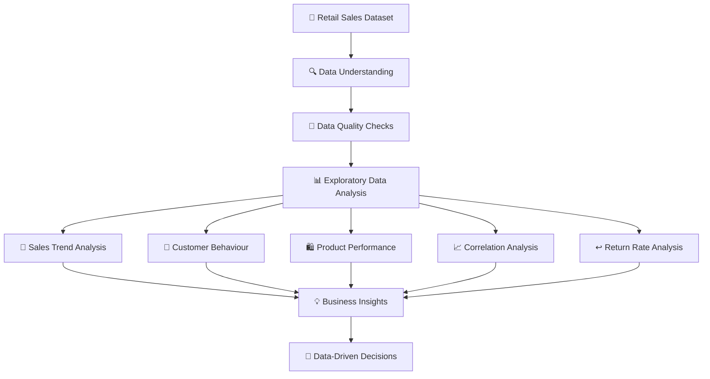

# 📊 RETAIL SALES ANALYTICS
### Exploratory Data Analysis | Python | Business Intelligence

<p align="center">
  
  
  
  
  
  
</p>

<p align="center">
  <b>Turning Retail Transaction Data into Meaningful Business Insights.</b>
</p>

---

## 🧭 Project Overview

Retail businesses generate large amounts of transaction data every day. However, raw data alone cannot explain customer behaviour, product performance, or sales patterns.

This project applies **Exploratory Data Analysis (EDA)** to a retail shopping dataset to uncover meaningful patterns, examine customer purchasing behaviour, evaluate product performance, and identify insights that can support business decisions.

The analysis was completed using Python and its data analytics ecosystem as part of the **Oasis Infobyte Data Analytics Internship – Task 1**.

## 📌 Project at a Glance

| Project Detail | Information |
|---|---|
| Project | Retail Sales Analytics |
| Analysis Type | Exploratory Data Analysis |
| Domain | Retail / E-commerce |
| Dataset Size | 10,000 records |
| Number of Features | 26 |
| Data Period | January 2023 – December 2024 |
| Programming Language | Python |
| Environment | Jupyter Notebook |
| Internship | Oasis Infobyte |
| Task | Task 1 |

---

## 🗺️ Project Workflow Map

The following map represents the complete analytical journey, from raw transaction data to business insights.



## 🧪 Analytical Roadmap

### 01 — Data Understanding & Preparation
- Imported the dataset using Pandas.
- Examined dataset dimensions, columns, and data types.
- Checked missing values and duplicate records.
- Generated descriptive statistical summaries.

### 02 — Sales Trend Analysis
- Analyzed monthly sales performance.
- Examined quarterly sales patterns.
- Explored changes in purchase amounts over time.

### 03 — Customer Behaviour Analysis
- Studied customer age-group distribution.
- Examined gender-wise transaction distribution.
- Compared average purchase amounts across age groups.

### 04 — Product Performance Analysis
- Identified the top 10 best-selling products by quantity.
- Compared revenue generated by product categories.
- Explored product-level purchasing patterns.

### 05 — Correlation & Statistical Analysis
- Generated a numerical correlation heatmap.
- Examined relationships between purchase quantity, purchase amount, delivery time, review ratings, and other numerical variables.

### 06 — Return Rate Analysis
- Calculated return rates across product categories.
- Compared category-level return patterns.
- Identified categories that may require further investigation.

---

## 🛠️ Technology Stack

| Technology | Application |
|---|---|
| Python | Core programming and analysis |
| Pandas | Data manipulation and aggregation |
| NumPy | Numerical operations |
| Matplotlib | Charts and visualizations |
| Seaborn | Statistical visualizations |
| Jupyter Notebook | Interactive analysis environment |

---

## 📊 Key Analytical Findings

The analysis revealed several useful relationships in the retail dataset.

### Correlation Analysis

| Variable Relationship | Correlation |
|---|---:|
| Quantity vs Purchase Amount | +0.37 |
| Delivery Time vs Review Rating | -0.33 |
| Age vs Purchase Amount | 0.00 |
| Age vs Quantity | -0.01 |

**Interpretation:**
- Purchase quantity has a moderate positive association with purchase amount.
- Delivery time has a moderate negative association with review rating.
- Age has almost no linear association with purchase amount or quantity in this dataset.

### Return Rate by Product Category

| Product Category | Return Rate |
|---|---:|
| Footwear | 19.09% |
| Clothing | 18.80% |
| Accessories | 10.12% |

**Business observations:**

- Footwear has the highest observed return rate.
- Clothing also shows a relatively high return rate.
- Accessories have a noticeably lower return rate.

These patterns could help retailers investigate product quality, sizing, customer expectations, and return-management processes.

> **Analytical note:** Correlation does not imply causation. The relationships observed here do not establish why a customer returned a product or gave a particular rating.

---

## 📈 Visualization Gallery

## 📊 Visualization Gallery

### 1. Monthly Sales Trend


### 2. Quarterly Sales Trend


### 3. Customer Age Group Distribution


### 4. Gender Distribution


### 5. Top 10 Best-Selling Products


### 6. Revenue by Product Category


### 7. Correlation Heatmap


### 8. Return Rate by Category


The project includes visual analysis covering the following areas:

| Visualization | Analytical Purpose |
|---|---|
| Monthly Sales Trend | Understand sales movement over time |
| Quarterly Sales Trend | Compare quarterly performance |
| Age Group Distribution | Examine customer demographics |
| Gender Distribution | Explore transaction distribution |
| Top 10 Products | Identify popular products |
| Category Revenue | Compare category contributions |
| Correlation Heatmap | Examine numerical relationships |
| Average Purchase by Age Group | Explore spending patterns |
| Category Return Rate | Identify return patterns |

*More chart screenshots can be added here as the project gallery is organized.*

---

## 📁 Repository Structure

```text
OIBSIP/
│
├── 📓 Retail_Sales_EDA.ipynb
│
├── 📂 dataset/
│   └── customer_shopping_behavior.xlsx.xlsx
│
├── 📂 assets/
│   └── charts/
│       ├── monthly_sales.png
│       ├── quarterly_sales.png
│       ├── top_products.png
│       ├── category_revenue.png
│       ├── correlation_heatmap.png
│       └── return_rate.png
│
├── 📄 README.md
└── 📄 requirements.txt
```

*The dataset and notebook are currently in the repository root. The folders shown above are the recommended organization for the next improvement.*

---

## ⚙️ Getting Started

Follow these steps to run the project locally.

### 1. Clone the repository

```bash
git clone https://github.com/priyankasunagar/OIBSIP.git
```

### 2. Navigate to the project directory

```bash
cd OIBSIP
```

### 3. Install the dependencies

```bash
pip install pandas numpy matplotlib seaborn openpyxl jupyter
```

### 4. Launch Jupyter Notebook

```bash
jupyter notebook
```

### 5. Open the analysis notebook

Open `Retail_Sales_EDA.ipynb` and execute the cells sequentially.

**Dataset requirement:** Keep `customer_shopping_behavior.xlsx.xlsx` in the location expected by the notebook's data-loading cell.

---

## 🎓 Learning Outcomes

Through this project, I strengthened my practical understanding of:

- Exploratory Data Analysis using Python.
- Data inspection and quality assessment.
- Data manipulation using Pandas and NumPy.
- Statistical exploration and correlation analysis.
- Data visualization using Matplotlib and Seaborn.
- Translating analytical results into business observations.

## 👩‍💻 About the Author

**Priyanka Sunagar**

Artificial Intelligence & Data Science Student  
Interested in Data Analytics, Business Intelligence, and AI-driven solutions.

- GitHub: [@priyankasunagar](https://github.com/priyankasunagar)
- Project: [OIBSIP Repository](https://github.com/priyankasunagar/OIBSIP)

## 🏢 Internship Acknowledgement

**Oasis Infobyte — Data Analytics Internship**

Project: Task 1 — Exploratory Data Analysis on Retail Sales Data.

---

<p align="center">
  <b>From Raw Data to Actionable Insights.</b>
  <br/>
  ⭐ If you find this project useful, consider giving the repository a star!
</p>
